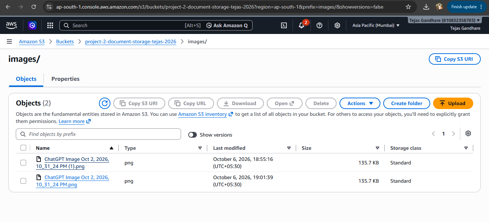
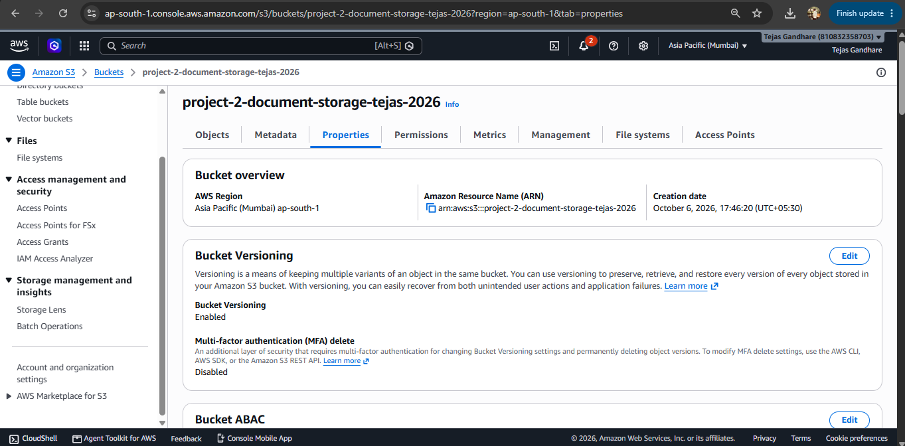

# AWS S3 Document Storage System

## Project Overview

This project demonstrates an Amazon S3-based document storage system for an organization. The system uses Amazon S3 to store and organize files in folders, configure appropriate access permissions, enable versioning, and recover an earlier version of a file.

## AWS Services Used

- Amazon S3
- AWS IAM / S3 Access Permissions

## Project Requirements

- Create an S3 bucket for document storage
- Organize files using S3 folders
- Upload documents/images into the folder
- Configure appropriate bucket/object access permissions
- Enable S3 Versioning
- Create multiple versions of a file
- Demonstrate recovery of an earlier file version

## Implementation

### 1. S3 Bucket Creation

Created an S3 bucket named:

```text
project-2-document-storage-tejas-2026
```

The bucket was created in the Mumbai AWS Region (`ap-south-1`).

### 2. Folder Organization

Created an `images` folder inside the bucket to organize uploaded files.

### 3. File Upload

Uploaded an image file into the `images` folder.

Example file:

```text
ChatGPT Image Oct 2, 2026, 10_31_24 PM.png
```

### 4. Access Permissions

Checked the object permissions and verified the **S3 Bucket Owner Enforced Object Ownership** setting.

The bucket uses controlled access instead of making the object publicly accessible.

### 5. Versioning

Enabled **Amazon S3 Versioning** for the bucket.

Multiple versions of the same file were created to demonstrate version control.

The Versions section showed:

- 1 Current Version
- 2 Earlier Versions

### 6. Earlier Version Recovery

An earlier version of the uploaded file was selected and copied back to the same `images` location.

The copy operation completed successfully, demonstrating that an earlier version of a file can be recovered using S3 Versioning.

## S3 Versioning Benefits

S3 Versioning helps protect files from accidental deletion or unwanted changes.

It allows organizations to:

- Keep previous versions of files
- Recover accidentally modified files
- Restore earlier versions
- Maintain a history of stored documents

## Project Result

The Amazon S3-based document storage system was successfully implemented with organized folders, controlled access permissions, versioning, and earlier-version recovery.

## AWS Region

```text
ap-south-1 (Mumbai)
```

## Screenshots


### 1. S3 Bucket Creation

> 

### 2. Folder and File Upload

> 

### 3. Access Permissions

>

### 4. Versioning

> 

### 5. Earlier Version Recovery

> 

## Conclusion

This project demonstrates how Amazon S3 can be used as a secure and reliable document storage solution for an organization. S3 Versioning provides an additional layer of protection by maintaining previous versions and allowing earlier files to be recovered when required.
